  

### Hi, I'm Anton 👋

Aerospace engineering student with a hands-on focus on embedded systems, automotive electronics and custom hardware builds.

- 🔧 **Hardware & Embedded:** ESP32, PlatformIO, CAN-Bus, sensor telemetry, 3D printing & CAD
- 💻 **Software & Infra:** Linux, Python, Home Assistant, self-hosted services
- 🌊 **Off-Screen:** Hydrofoil sailing, alpine skiing, wakeboarding & ice skating

#### 🛠️ Currently building

**GPS-Fusion** – a speed display for a foiling Mach2 dinghy. A 10 Hz GNSS receiver and a 100 Hz IMU are fused in a Kalman filter on an ESP32, so the number on the transflective screen is instant, smooth and free of GPS glitches. Custom carrier PCB in KiCad, rides logged at 10 Hz and downloadable over Wi-Fi.

#### 🧰 Toolbox

